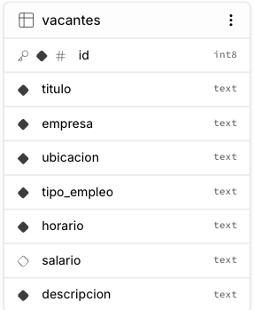

## Diagrama de base de datos

Esto representa la tabla que se creo en la base de datos. Esta tabla es la que se encarga de almacenar la informacion y asi poder
mostrar el listado de vacantes cuando sea necesario tambien para poder realizar las busquedas, filtros y poder consultar los detalles de 
cada vacante.